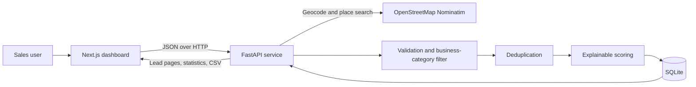

# LeadForge AI

LeadForge AI is a focused B2B lead-discovery and qualification workspace built for the Caprae Capital full-stack assignment. It discovers real public business listings through OpenStreetMap's Nominatim service, ranks them with an explainable deterministic score, removes duplicate and non-business records, saves valid results, and exports an outreach-ready CSV.

The product does **not** invent employee counts, revenue, contact people, emails, or phone numbers. Missing values remain visibly missing, and every discovered lead retains a link to its public source. “AI” is the product name; the current scorer is rule-based and does not use an LLM.

## Assignment submission

- [Video walkthrough](submission/video/Caprae_Capital_LeadForge_Demo.mp4) — a verified 119.5-second, 1080p demonstration of live discovery, explainable scoring, filtering, pagination, and CSV export
- [Caprae Capital business answers](submission/CAPRAE_BUSINESS_ANSWERS.md)
- [Employment questionnaire](submission/EMPLOYMENT_ANSWERS_FINAL.md) — candidate-approved public responses
- [Submission overview](submission/README.md)

The walkthrough uses real OpenStreetMap results and demonstrates the running application rather than mocked or fabricated functionality.

## Business problem

Raw business directories create work instead of saving it when records are duplicated, irrelevant, incomplete, or impossible to prioritize. Sales and acquisition teams need a narrower list with clear provenance, consistent qualification criteria, and an output they can immediately use.

LeadForge AI addresses that workflow in one place:

1. Find businesses for an industry or keyword and location.
2. Exclude obvious non-business place matches.
3. Deduplicate repeated entities.
4. Rank remaining leads using visible business-fit evidence.
5. Filter, select, and export the shortlist.

## Implemented features

- Live OpenStreetMap discovery through Nominatim geocoding and place search
- Transparent 100-point scoring with a per-lead explanation
- Deterministic deduplication by source identity, domain, or name/location fingerprint
- Explicit reporting of duplicates and excluded non-business results
- SQLite persistence for searches and leads
- Indexed pagination, minimum-score filtering, completeness filtering, text search, and sorting
- Full-list and selected-row CSV export
- Spreadsheet formula-injection protection in exported text cells
- Responsive desktop table and mobile lead-card layouts
- Loading, error, empty, success, and disabled states
- OpenStreetMap attribution and direct source links

## Technology stack

| Layer | Technology |
| --- | --- |
| Frontend | Next.js 16, React 19, strict TypeScript, CSS, Lucide icons |
| Backend | FastAPI, Pydantic, HTTPX, Uvicorn |
| Persistence | SQLite using Python's standard `sqlite3` module |
| External data | OpenStreetMap Nominatim |
| Quality | Pytest, strict mypy, Ruff, ESLint, Next.js production build |

## Architecture



The API owns discovery, data-quality rules, scoring, persistence, and export. The browser never calls the external provider directly, which keeps provider policy, error handling, and provenance consistent.

## Database and persistence

The assessment uses SQLite at `backend/data/leadforge.db` (configurable with `DATABASE_PATH`). The file is runtime data and is excluded from Git.

`searches` records the keyword, location, raw result count, duplicate count, and timestamp. `leads` stores the validated JSON payload plus indexed fields needed for filtering and sorting. Indexes cover score, city, discovery time, and the deduplication fingerprint. Re-discovering an existing OpenStreetMap source updates the stored lead instead of creating another row.

SQLite keeps evaluator setup portable. A multi-user deployment should migrate the same model to PostgreSQL, add migrations and connection pooling, and associate records with authenticated workspaces.

## Data source and responsible usage

Business and location data comes from OpenStreetMap through Nominatim. LeadForge AI:

- sends an identifiable, configurable user agent;
- serializes discovery requests;
- stays below the public one-request-per-second ceiling;
- caches identical searches in process; and
- displays OpenStreetMap attribution and source links.

OpenStreetMap is open, useful discovery data—not a complete commercial enrichment provider. Coverage, categorization, and contact-field freshness vary by region. A public product should use a hosted provider or dedicated Nominatim instance with a service-level agreement.

## Scoring algorithm

Every lead receives a deterministic score from 0 to 100:

| Factor | Weight | Behavior |
| --- | ---: | --- |
| Keyword relevance | 35 | Full, partial, or fallback match across public name/category fields |
| Location proximity | 25 | Distance bands from the geocoded search center |
| Data completeness | 25 | Public website, phone, email, and street/full-address fields |
| Business signals | 15 | Opening hours, operator/brand, public knowledge links, and start date |

The score disclosure shows the exact component totals. Missing data earns no completeness points and is shown as missing; it is never inferred. A score of 65 or above is counted as qualified in dashboard statistics. Filters also support 55+, 65+, and 75+ thresholds.

## Deduplication and data quality

Deduplication first removes repeated OpenStreetMap source IDs. It then uses a normalized website domain when available, otherwise a normalized company name plus rounded coordinates. When two candidates collide, the higher-scoring public record is retained. Nominatim categories that represent boundaries, roads, neighborhoods, or other non-business places are excluded and reported separately from duplicates.

## Performance

- Server-side pagination limits each page to 10 rows.
- SQLite indexes support the most common filter and sort paths.
- API query limits bound discovery, pagination, text input, and export sizes.
- Identical discovery searches are cached for 15 minutes by default.
- A single asynchronous lock serializes public Nominatim access to respect its policy.
- The frontend debounces text filters and cancels stale list requests.

## Security and reliability

Implemented safeguards include:

- strict request validation and bounded input lengths;
- parameter-bound SQLite values and an allow-listed sort expression;
- formula-injection escaping for CSV cells beginning with `=`, `+`, `-`, `@`, tab, or carriage return;
- HTTP(S)-only external website links in the UI;
- explicit CORS origins rather than a wildcard;
- generic upstream failure messages without leaking internals; and
- Git exclusions for secrets, databases, virtual environments, dependencies, and build output.

This assessment intentionally has no authentication, authorization, tenant isolation, CSRF protection, durable distributed rate limiting, or production secrets manager. Do not expose the state-changing API publicly until those controls exist.

## Run locally on Windows

Prerequisites: Node.js 20+ and Python 3.11+.

### Backend

```powershell
cd backend
python -m venv .venv
.venv\Scripts\Activate.ps1
python -m pip install -e ".[dev]"
Copy-Item .env.example .env
uvicorn app.main:app --reload --port 8000
```

Update `OSM_USER_AGENT` in `backend/.env` with a real contact address before sustained use.

### Frontend

In a second PowerShell terminal:

```powershell
cd frontend
npm install
Copy-Item .env.example .env.local
npm run dev
```

Open http://localhost:3000. The default backend URL is http://localhost:8000.

## Testing and verified build

```powershell
cd backend
python -m pytest -q
python -m mypy app
python -m ruff check app tests

cd ..\frontend
npm run lint
npm run typecheck
npm run build
npm audit --audit-level=high
```

The verified release candidate passed 9 backend tests, strict Python and TypeScript checks, linting, the optimized Next.js build, and a zero-vulnerability npm audit.

## Deployment status

The application is verified locally and is **not currently publicly deployed**. See [`docs/DEPLOYMENT_STATUS.md`](docs/DEPLOYMENT_STATUS.md) for a realistic Vercel/Render/PostgreSQL path and its required security work.

## Current limitations

- OpenStreetMap coverage and tagging quality vary by category and region.
- Public Nominatim is unsuitable for an unrestricted, high-volume public application.
- SQLite and the in-process cache are single-instance choices.
- No authentication, user accounts, workspace separation, or role-based access exists.
- Public contact fields may be absent or stale; LeadForge AI reports them without independent verification.
- The scoring weights are transparent heuristics, not a trained model or investment recommendation.

## Future improvements

Future work—not currently implemented—could include PostgreSQL and Redis, authenticated workspaces, commercial data-provider enrichment, configurable scoring weights, CRM integrations, background exports, data-freshness checks, and observability. An LLM could later summarize verified source data, but it should not invent qualification evidence.

## Demo flow

1. Search for `coffee` in `Austin, Texas`.
2. Open a top score to show the component breakdown.
3. Filter to 75+ and select a lead.
4. Export the selected CSV.
5. Explain the saved-leads metric, source links, and missing-data behavior.

## License and attribution

Business and location data: © [OpenStreetMap contributors](https://www.openstreetmap.org/copyright), available under the Open Database License.
